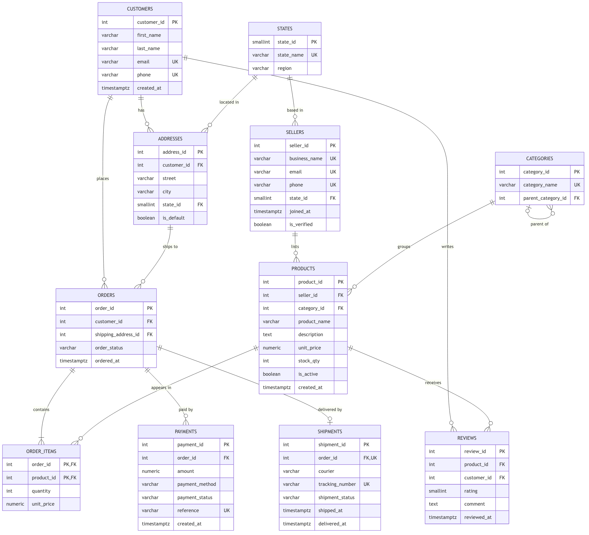
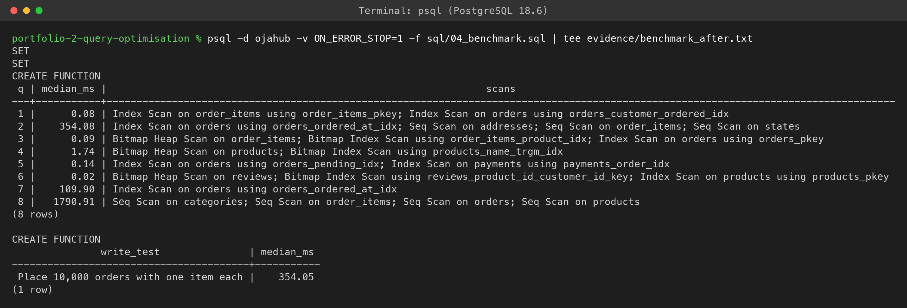
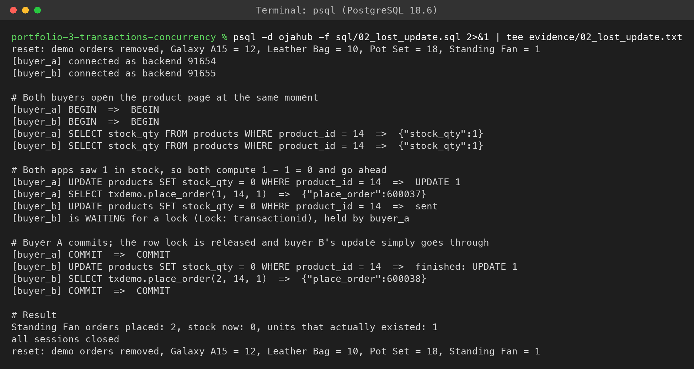
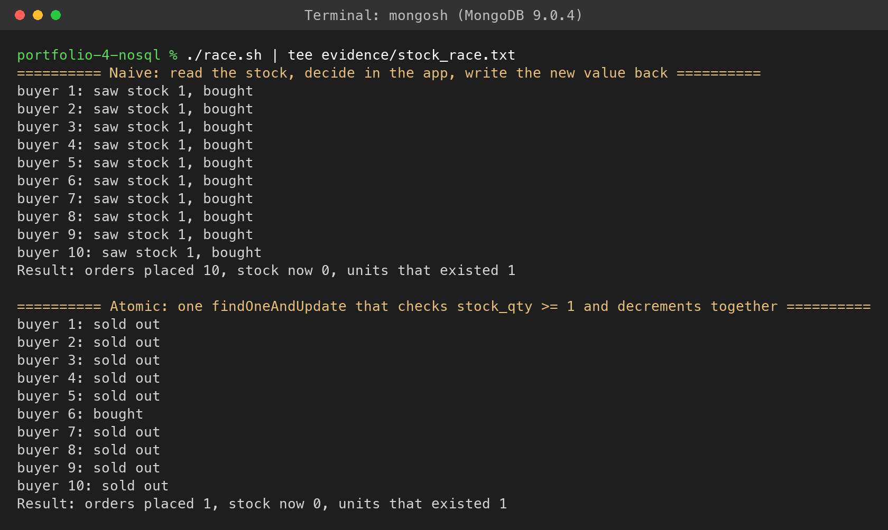
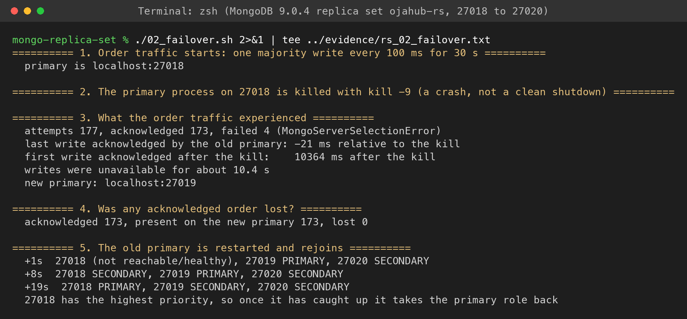

<!--
  Source for the LMS documentation. Edit this file, then rebuild the PDF with:
      final-documentation/build.sh
  Before submitting:
    1. Write the "Use of AI" section yourself.
    2. Rewrite the reflection in your own words.
-->

# Advanced Database Systems Portfolio

<strong>David-Paul Folorunsho-Roberts</strong> &nbsp;|&nbsp; Student ID 2026/A/MIT/0268 &nbsp;|&nbsp; MIT 8103 Advanced Database Systems &nbsp;|&nbsp; 2026/2027 First Semester 
GitHub repository: <a href="https://github.com/davidcreated/advanced-database-portfolio">github.com/davidcreated/advanced-database-portfolio</a> (private, with access granted to the assessor)

## Selected Organisation: OjaHub Marketplace

OjaHub is a simulated Nigerian online marketplace ("oja" means market in Yoruba). Independent sellers open a shop and list products, and customers in all 36 states and the FCT order, pay and receive deliveries through courier partners. I used it as the single case study across all five activities.

**Users of the database:** customers (browse, order, pay, review), sellers (manage products and stock), operations staff (payments, shipments, disputes) and management (sales reports by region, category and seller).

**Major data:** customers and addresses, sellers, product categories, products and stock, orders and order items, payments (including failed attempts), shipments and reviews.

**Key operations:** register users, manage products and stock, place an order and reduce stock safely when many people buy at once, process payments and retries, track delivery, and produce sales reports.

## Portfolio 1: Database Design and Modelling

I designed an 11 table relational schema in PostgreSQL 18 and walked a flat order spreadsheet through 1NF, 2NF and 3NF, then checked every table against BCNF. Business rules live in the database as primary, foreign and unique keys and CHECK constraints, plus two partial unique indexes: one default address per customer, and one successful payment per order while still allowing failed retries. All 14 rule breaking test statements were rejected by the exact constraint they targeted, and a valid retry was accepted. Evidence: ER diagram, schema, normalisation write up and constraint test output.

## Portfolio 2: Query Processing and Optimisation

I generated about 2.9 million deterministic rows (500,010 orders, 1.07 million order items) and benchmarked eight business queries with `EXPLAIN (ANALYZE, BUFFERS)`, reporting the median of six warm runs.

| Query | Before | After | What fixed it |
| --- | --- | --- | --- |
| Customer order history | 11.44 ms | 0.08 ms | Index on the unindexed foreign key |
| One product's sales | 38.87 ms | 0.09 ms | Index on the unindexed foreign key |
| Product name search | 40.89 ms | 1.74 ms | Trigram GIN index |
| Stuck pending orders | 56.95 ms | 0.14 ms | Partial index (56 kB against 19 MB for a full one) |
| Monthly sales report | 2,109 ms | 0.06 ms | Materialised view (refresh about 1.7 s) |

Indexes did nothing for the reporting queries, and the plans showed why. They also made writes about 23 percent slower, which I measured too.

## Portfolio 3: Transactions and Concurrency

Using dblink to script several real sessions in a fixed order, I showed commit, rollback, a transaction poisoned by an error, and a savepoint. Two buyers racing for the last Standing Fan under READ COMMITTED both succeeded, so one fan was sold twice. `SELECT ... FOR UPDATE`, an atomic conditional UPDATE and REPEATABLE READ each fixed it with exactly one order. A report saw phantom and non repeatable reads under READ COMMITTED but a stable snapshot under REPEATABLE READ. Write skew broke a business rule under REPEATABLE READ and was rejected under SERIALIZABLE (SQLSTATE 40001). A deadlock was detected and resolved (40P01), then prevented by locking in a fixed order.

## Portfolio 4: NoSQL and Advanced Data Models

I modelled OjaHub as MongoDB documents: products with category specific attributes and a subset of recent reviews, and orders embedding their items, payments and shipment as a snapshot of the day. All 760,088 documents migrated from PostgreSQL and passed `$jsonSchema` validation, with counts and spot checked totals matching. Indexing cut a customer's order history from scanning 500,010 documents (80.32 ms) to reading 10 (0.39 ms). With ten concurrent buyers, a naive read and write sold one fan ten times, while one atomic `findOneAndUpdate` sold it once. Compared side by side, MongoDB served the order page faster (0.54 ms against 1.16 ms) and PostgreSQL won substring search (1.52 ms against 3.96 ms). My conclusion is polyglot persistence: MongoDB for the catalogue and order pages, PostgreSQL for money, stock and reporting.

## Portfolio 5: Distributed and Cloud Database Exercise

I ran real clusters locally and wrote a cloud deployment design from the results.

| Setup | Key result |
| --- | --- |
| PostgreSQL streaming replica | Lag peaked near 8 MB and 0.19 s during a million row write. Synchronous commits rose from 0.089 ms to 0.143 ms, and with the standby down a commit waited until cancelled. Promotion took 133 ms and showed split brain |
| MongoDB three member replica set | Killing the primary stopped writes for 10.4 s, with 0 of 173 acknowledged writes lost. Reads from a secondary were stale 126 times in 300, and 0 in a causally consistent session |
| MongoDB sharded cluster | Zone sharding put 209,572 northern orders on one shard and 290,438 southern orders on the other. Region queries hit one shard, while customer queries had to ask both |

The design places payments and stock on PostgreSQL with a synchronous standby in a second availability zone, and the catalogue on a majority write MongoDB replica set. It also covers data residency, backups, and a CAP and PACELC reading of each choice.

## Use of AI

<em>To be completed by the student before submission.</em>

## Individual Technical Reflection

**Design choices.** I chose an online marketplace because it carries every topic in the course: money, stock that runs out, flexible product data and regional customers. The choice I am happiest with was storing the price paid on each order item separately from the product's list price. It looked like duplication in Portfolio 1, but the same idea came back as the order snapshot in the MongoDB model.

**Challenges.** The hardest part was making the results honest. Heavy queries varied by 30 to 60 percent between runs, so I had to compare medians and only trust large differences. Twice my laptop went to sleep on battery in the middle of a run and made the database look broken, until I checked the power log. Some of my predictions were also wrong: the planner used an index I expected it to ignore, and a synchronous commit hung even with a statement timeout.

**Lessons learned.** Read the execution plan before adding an index. A transaction is only as safe as the logic inside it, as the lost update showed. Denormalising and replicating data are trade offs that have to be chosen on purpose, not free speed. Seeing a 10 second election, a split brain and 126 stale reads made consistency and availability feel concrete rather than theoretical.

## Appendix: Selected Evidence

<figure><figcaption>Portfolio 1: ER diagram of the OjaHub schema in crow's foot notation.</figcaption></figure>

<figure><figcaption>Portfolio 2: benchmark after indexing, with medians and the scan type chosen for each query.</figcaption></figure>

<figure><figcaption>Portfolio 3: the lost update, two orders placed for one Standing Fan under READ COMMITTED.</figcaption></figure>

<figure><figcaption>Portfolio 4: ten concurrent buyers in MongoDB, naive read and write against one atomic update.</figcaption></figure>

<figure><figcaption>Portfolio 5: replica set failover under write traffic, 10.4 s without writes and no acknowledged write lost.</figcaption></figure>
