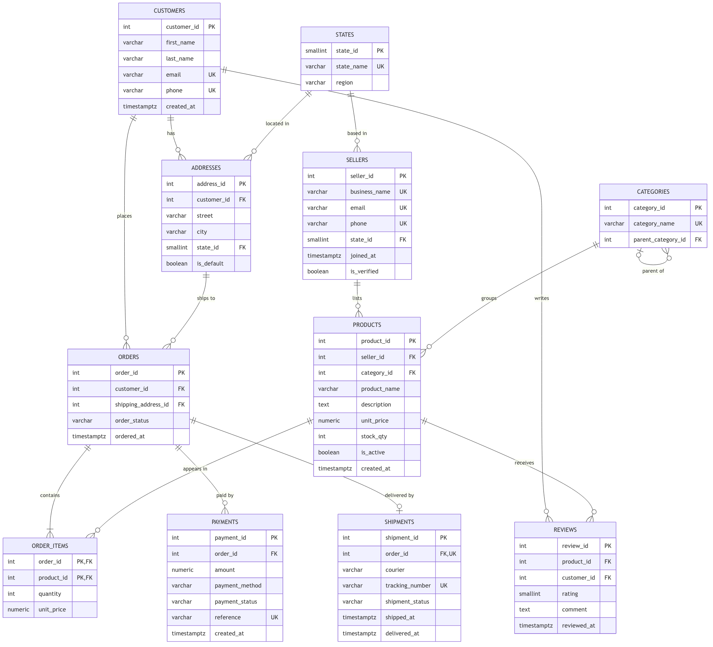

# Portfolio 1: Database Design and Modelling

This activity covers the relational design for OjaHub Marketplace, my case study for the whole course. The full case study statement is in the [main README](../README.md).


## What Is in This Folder

| File | Purpose |
| --- | --- |
| [er-diagram.png](er-diagram.png) | ER diagram in crow's foot notation |
| [er-diagram.mmd](er-diagram.mmd) | Mermaid source for the diagram |
| [normalisation.md](normalisation.md) | How I went from a flat order sheet to 1NF, 2NF, 3NF and BCNF |
| [sql/01_schema.sql](sql/01_schema.sql) | Creates all eleven tables with keys and constraints |
| [sql/02_seed.sql](sql/02_seed.sql) | Loads realistic sample data |
| [sql/03_constraint_tests.sql](sql/03_constraint_tests.sql) | Tries to break each business rule |
| [evidence/](evidence/) | Real psql output from running the scripts |


## ER Diagram



The main flow reads from top to bottom. A customer has addresses and places orders. Each order contains one or more order items, can have several payment attempts, and has at most one shipment. On the product side, a seller lists products and each product sits in a category, which can itself sit under a parent category (Phones under Electronics, Fabrics under Fashion). States connect to both addresses and sellers, which will matter later when I look at regional reporting and sharding.


## Relational Schema

```
states      (state_id PK, state_name UK, region)
customers   (customer_id PK, first_name, last_name, email UK, phone UK, created_at)
addresses   (address_id PK, customer_id FK, street, city, state_id FK, is_default)
sellers     (seller_id PK, business_name UK, email UK, phone UK, state_id FK, joined_at, is_verified)
categories  (category_id PK, category_name UK, parent_category_id FK)
products    (product_id PK, seller_id FK, category_id FK, product_name, description,
             unit_price, stock_qty, is_active, created_at)
orders      (order_id PK, customer_id FK, shipping_address_id FK, order_status, ordered_at)
order_items (order_id PK FK, product_id PK FK, quantity, unit_price)
payments    (payment_id PK, order_id FK, amount, payment_method, payment_status, reference UK, created_at)
shipments   (shipment_id PK, order_id FK UK, courier, tracking_number UK, shipment_status,
             shipped_at, delivered_at)
reviews     (review_id PK, product_id FK, customer_id FK, rating, comment, reviewed_at)
```


## Keys

**Primary keys.** I used surrogate integer keys (`GENERATED ALWAYS AS IDENTITY`) for every main entity. Natural candidates like email or phone can change, and I did not want a customer changing their email to ripple through every order. The exception is order_items, where the natural composite key (order_id, product_id) is exactly right, since a product appears once per order with a quantity.

**Alternate keys.** The natural identifiers are still protected with UNIQUE: customer and seller email and phone, business name, payment reference, tracking number and (seller_id, product_name).

**Foreign keys.** I chose the delete behaviour for each one on purpose:

1. **CASCADE** where the child has no meaning without the parent: a customer's addresses and reviews, and the items inside an order.
2. **RESTRICT** where deleting would destroy business history: you cannot delete a seller who still has products, a product that has been ordered, or an order that has payments.


## Constraints and the Business Rules They Enforce

| Rule | How it is enforced |
| --- | --- |
| Prices must be above zero | `CHECK (unit_price > 0)` |
| Stock can never go negative | `CHECK (stock_qty >= 0)` |
| Ratings are 1 to 5 | `CHECK (rating BETWEEN 1 AND 5)` |
| Phone numbers use the +234 format | `CHECK (phone ~ '^\+234[0-9]{10}$')` |
| Order, payment and shipment statuses come from a fixed list | `CHECK (... IN (...))` |
| A parcel cannot be delivered before it is shipped | table CHECK on shipments |
| A category cannot be its own parent | table CHECK on categories |
| One review per customer per product | `UNIQUE (product_id, customer_id)` |
| Only one default address per customer | partial unique index `WHERE is_default` |
| Failed payments can be retried, but an order is only paid once | partial unique index `WHERE payment_status = 'successful'` |

The last two were the most interesting to design. A plain UNIQUE on payments.order_id would block legitimate retries after a failed card payment, which happens all the time with Nigerian card payments. A partial unique index lets me have as many failed attempts as needed while still making a double charge impossible at the database level.

The stock rule will come back in Portfolio 3, because the CHECK alone stops stock going negative but does not stop two buyers from both being told the last item is available.


## Normalisation

The full walk through is in [normalisation.md](normalisation.md). In short, the schema is in 3NF and I checked it against BCNF table by table. The one place that looks like duplication, unit_price on both products and order_items, is deliberate: one is today's price and the other is the price the customer actually paid.


## How I Ran and Tested It

Environment: PostgreSQL 18.6 installed with Homebrew on macOS.

```bash
brew install postgresql@18
brew services start postgresql@18
export PATH=/opt/homebrew/opt/postgresql@18/bin:$PATH

createdb ojahub
psql -d ojahub -v ON_ERROR_STOP=1 -f sql/01_schema.sql
psql -d ojahub -v ON_ERROR_STOP=1 -f sql/02_seed.sql
psql -d ojahub -e -f sql/03_constraint_tests.sql
```

The schema script drops and recreates the `ojahub` schema, so the three scripts can be rerun from a clean state at any time.

**Results after loading the seed data:**

| Table | Rows |
| --- | --- |
| states | 37 |
| customers | 10 |
| addresses | 11 |
| sellers | 5 |
| categories | 8 |
| products | 14 |
| orders | 10 |
| order_items | 16 |
| payments | 12 |
| shipments | 8 |
| reviews | 6 |

I also checked that every successful payment amount matches the sum of its order items, and that every review was written by a customer who actually bought that product. Both checks came back clean.

**Constraint tests:** the test script runs fourteen statements that each break one rule. All fourteen were rejected by the exact constraint they targeted. Test 15 confirms that a failed payment retry is still accepted, and the final row counts show the data was left unchanged. The full output is in [evidence/constraint_tests.txt](evidence/constraint_tests.txt), and a describe of every table is in [evidence/schema_describe.txt](evidence/schema_describe.txt).


## What I Would Revisit

The order total is not stored, it is calculated from order_items. That is the right call for consistency, but if sales reports become slow with a large order history, I may add a materialised view in Portfolio 2 rather than a stored column.
