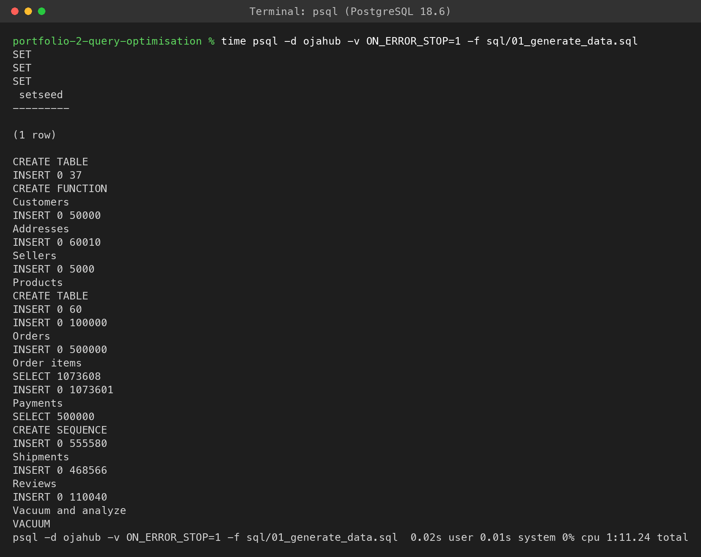
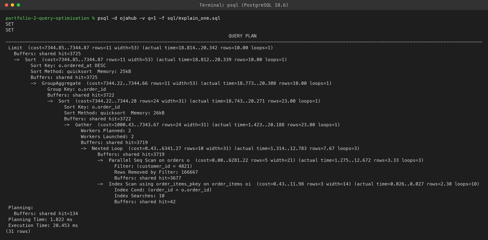
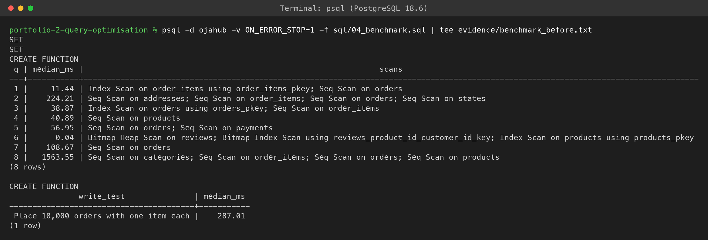
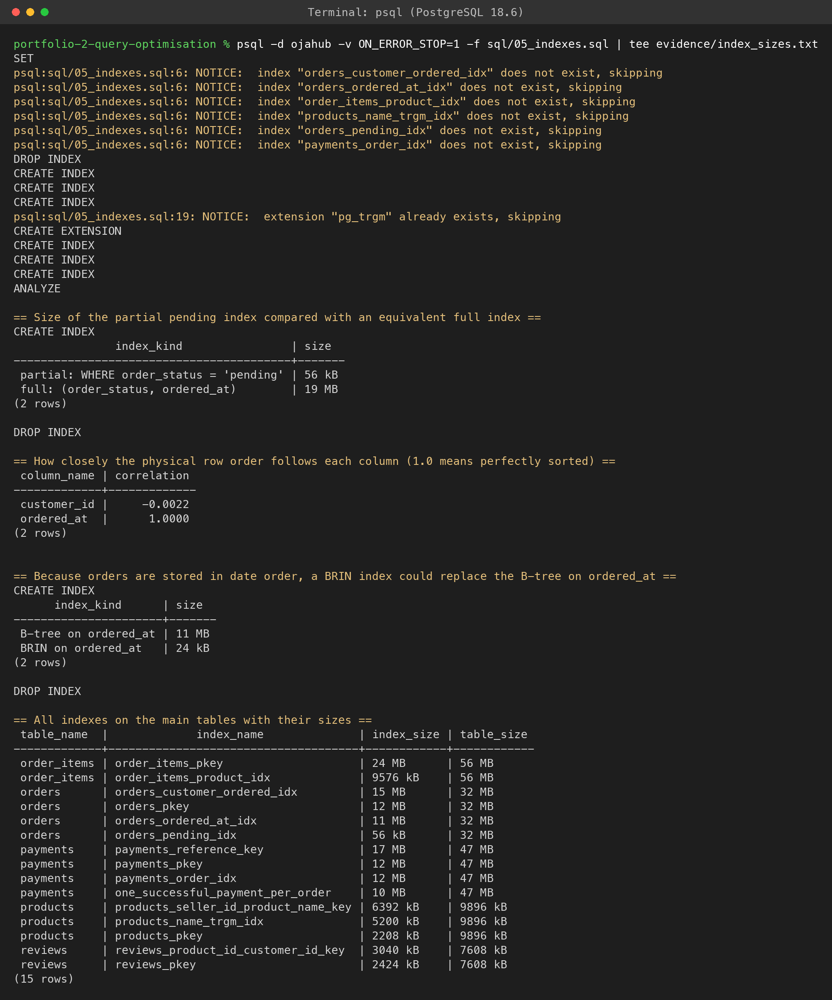
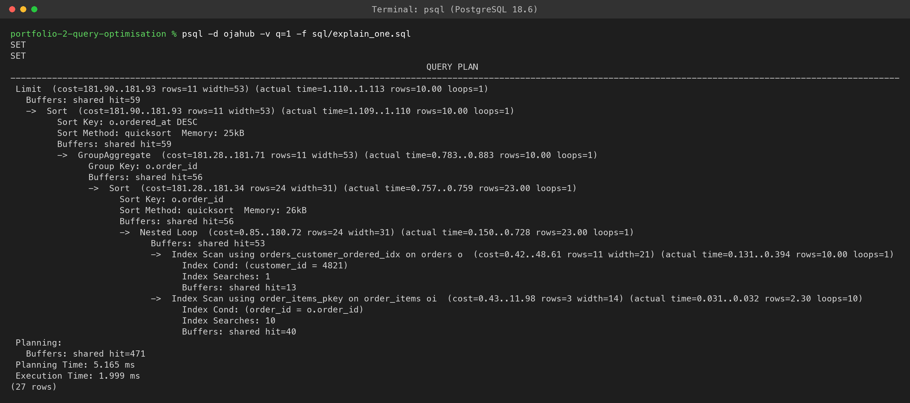
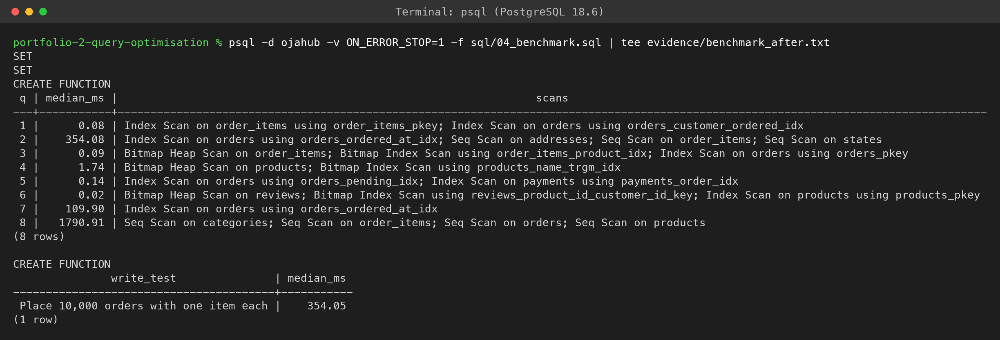
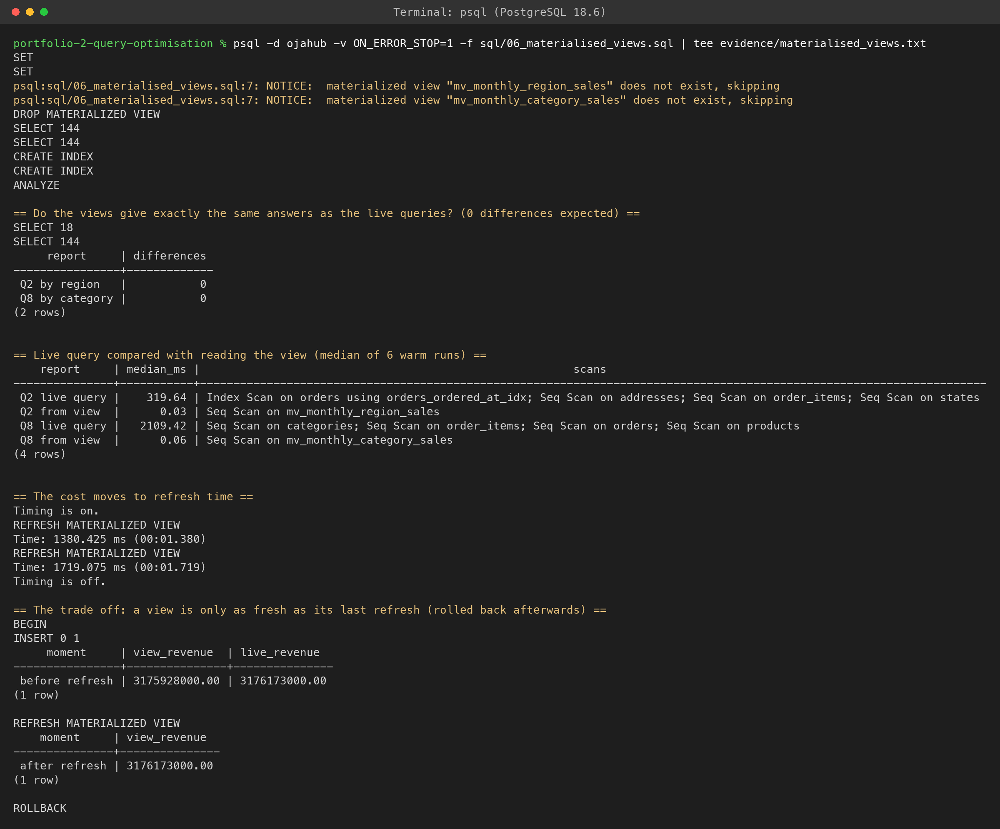

# Portfolio 2: Query Processing and Optimisation

This activity takes the OjaHub schema from [Portfolio 1](../portfolio-1-database-design/), fills it with a realistic volume of data, and looks at how PostgreSQL actually executes the questions the business asks. For each query I captured the execution plan, added indexes where the plan showed a real problem, and measured the result before and after.

The short version: indexes made the lookup queries hundreds of times faster, did nothing for the reporting queries, and made writes about a quarter slower. The reporting queries needed a different tool altogether.


## What Is in This Folder

| File | Purpose |
| --- | --- |
| [sql/01_generate_data.sql](sql/01_generate_data.sql) | Adds about 2.9 million rows on top of the Portfolio 1 seed |
| [sql/02_queries.sql](sql/02_queries.sql) | The eight business queries, stored once in `perf.queries`, and their results |
| [sql/03_explain.sql](sql/03_explain.sql) | `EXPLAIN (ANALYZE, BUFFERS)` for every query |
| [sql/04_benchmark.sql](sql/04_benchmark.sql) | Median timings for every query, plus a write test |
| [sql/05_indexes.sql](sql/05_indexes.sql) | The indexes I added, why, and what they cost in space |
| [sql/06_materialised_views.sql](sql/06_materialised_views.sql) | Materialised views for the two reporting queries |
| [sql/explain_one.sql](sql/explain_one.sql) | Plan for a single query, used for the screenshots |
| [evidence/](evidence/) | Full psql output from the final clean run |
| [screenshots/](screenshots/) | Screenshots of that run |


## The Test Data

Ten orders are not enough to learn anything, because PostgreSQL will happily scan a tiny table no matter what indexes exist. So I wrote a generator that adds data on the scale of a mid sized Nigerian marketplace:

| Table | Rows |
| --- | --- |
| customers | 50,010 |
| addresses | 60,021 |
| sellers | 5,005 |
| products | 100,014 |
| orders | 500,010 |
| order_items | 1,073,617 |
| payments | 555,592 |
| shipments | 468,574 |
| reviews | 110,046 |

I tried to make it behave like real data rather than evenly spread noise. Lagos takes about a quarter of all orders, followed by the FCT, Kano, Rivers and Oyo. Orders grow over the two years, 93 percent end up delivered and 6 percent cancelled, and about one in eight successful payments follows a failed card attempt. Ratings lean positive, as they do on most marketplaces.

The generator uses a fixed random seed and turns off parallel workers, so every rebuild produces identical rows. I checked this by fingerprinting the data on two separate builds and got the same hash both times. The Portfolio 1 integrity checks also still return zero rows on the full dataset.

One thing caught me out while writing it. My first version gave nobody a second address, because PostgreSQL pushed my `random() < 0.2` filter down onto a two row `generate_series` and evaluated it only once for everybody. Moving the random draw into a subquery over customers fixed it.


## The Queries

| No. | Business question |
| --- | --- |
| Q1 | Order history for one customer, newest first |
| Q2 | Monthly revenue by region for the last quarter |
| Q3 | Monthly sales history for one product (seller dashboard) |
| Q4 | Customer search for products whose name contains "basmati" |
| Q5 | Operations queue: the oldest 50 orders still pending after 3 days |
| Q6 | Average rating and review count for one product |
| Q7 | Delivered orders per month this year |
| Q8 | Monthly sales report by category across all time |

Each query is stored once in a `perf.queries` table, and the results, EXPLAIN and benchmark scripts all read from there. That way the SQL I timed is exactly the SQL I explained. Dates are fixed to 31 October 2026 so the answers do not change when the scripts are rerun later.


## How I Measured

Every query runs 7 times through `EXPLAIN (ANALYZE, FORMAT JSON)`. The first run only warms the cache and is thrown away, and I report the median of the other six. The benchmark function also reads the plan and lists which scans were used, so each timing comes with the reason behind it.

I ran everything on an Apple M4 MacBook Air with 16 GB of RAM and PostgreSQL 18.6 on default settings.

One honest caveat: the heavy queries are noisy. Q8 uses exactly the same plan in every run, yet across the runs recorded in this branch's history it measured anywhere from 1,123 ms to 1,791 ms. So I only treat a change as real when it is far bigger than that, which the lookup queries clearly are.


## Results

| Query | Before (ms) | After (ms) | Plan before | Plan after |
| --- | --- | --- | --- | --- |
| Q1 customer history | 11.44 | 0.08 | Seq Scan on orders | Index Scan on orders_customer_ordered_idx |
| Q2 regional revenue | 224.21 | 354.08 | Seq Scan on orders | Index Scan on orders_ordered_at_idx |
| Q3 product sales | 38.87 | 0.09 | Seq Scan on order_items | Bitmap Index Scan on order_items_product_idx |
| Q4 product search | 40.89 | 1.74 | Seq Scan on products | Bitmap Index Scan on products_name_trgm_idx |
| Q5 pending queue | 56.95 | 0.14 | Seq Scan on orders and payments | Index Scans on orders_pending_idx and payments_order_idx |
| Q6 product rating | 0.04 | 0.02 | Existing unique index on reviews | Unchanged |
| Q7 delivered this year | 108.67 | 109.90 | Seq Scan on orders | Index Scan on orders_ordered_at_idx |
| Q8 sales report | 1,563.55 | 1,790.91 | Seq Scans | Unchanged |

Source: [benchmark_before.txt](evidence/benchmark_before.txt) and [benchmark_after.txt](evidence/benchmark_after.txt). The full plans are in [plans_before.txt](evidence/plans_before.txt) and [plans_after.txt](evidence/plans_after.txt).


## What the Plans Showed

**Q1 and Q3: foreign keys are not indexed for you.** This was the biggest lesson. PostgreSQL creates an index for every primary key and unique constraint, but not for foreign keys. So finding one customer's orders meant reading all 500,000 orders, and finding one product's sales meant reading over a million order items. Indexing `orders(customer_id, ordered_at)` and `order_items(product_id)` turned both into direct lookups: Q1 went from 11.44 ms to 0.08 ms, and Q3 from 38.87 ms to 0.09 ms.

**Q4: a B-tree cannot help with a leading wildcard.** `ILIKE '%basmati%'` could match anywhere in the name, so an ordinary index is useless. The pg_trgm extension indexes every three letter fragment, and a GIN index on those took the search from 40.89 ms to 1.74 ms.

**Q5: index only the rows you care about.** Only about 0.3 percent of orders are pending. A partial index `WHERE order_status = 'pending'` covers exactly those, and it is 56 kB against 19 MB for the equivalent full index. Q5 dropped from 56.95 ms to 0.14 ms. It also needed an index on `payments(order_id)`, because the only existing index there was the partial unique one for successful payments.

**Q6: the right index already existed.** The Portfolio 1 rule of one review per customer per product created a unique index on `(product_id, customer_id)`. Because product_id comes first, PostgreSQL uses it for product lookups too, so Q6 was fast from the start and needed nothing.

**Q7: the planner switched to my index, and it made no difference.** I expected PostgreSQL to ignore the new date index, since 45 percent of all orders match. It used it anyway. The reason is in the statistics: the correlation of `ordered_at` is 1.0, meaning the orders sit on disk in date order. An index range scan therefore reads the table pages in sequence, just like a full scan would, and the time stayed at about 109 ms either way. The same fact means a BRIN index, which only stores the date range per block, would do this job at 24 kB instead of the 11 MB B-tree.

**Q2 and Q8: the cost was never in finding the rows.** For Q2 the date index did make reading orders a little quicker, but most of the time goes on joining about 156,000 order item rows and sorting them for the `count(DISTINCT ...)`. Q8 reads everything, so no index can help at all. The before and after differences for these two are inside the noise I described above.


## Materialised Views for the Reports

Since indexes could not help Q2 and Q8, I pre-computed them as materialised views: monthly revenue by region and monthly revenue by category.

| Report | Live query (ms) | From the view (ms) |
| --- | --- | --- |
| Q2 regional revenue | 319.64 | 0.03 |
| Q8 sales by category | 2,109.42 | 0.06 |

The script first proves the views are correct by comparing them with the live queries in both directions using `EXCEPT`, and both comparisons return zero differences.

The catch is that the work does not disappear, it moves. Refreshing the two views took 1.38 s and 1.72 s, and in between refreshes the view is out of date. The script shows this inside a transaction that is rolled back afterwards: after adding a ₦245,000 order, the view still reported ₦3,175,928,000 for the South West in October while the live total was ₦3,176,173,000. After a refresh they matched. For a management report refreshed every hour or overnight, that trade is clearly worth it. For anything a customer sees, it would not be.

I gave both views a unique index so they can be refreshed with `CONCURRENTLY`, which keeps them readable while the refresh runs.

Full output: [materialised_views.txt](evidence/materialised_views.txt).


## What the Indexes Cost

Indexes are not free, and I wanted numbers for that side too.

**Writes.** The benchmark places 10,000 orders with one item each inside a subtransaction that is rolled back, so nothing is kept. That took 287.01 ms before the new indexes and 354.05 ms after, about 23 percent slower, because every insert now has to update the extra indexes on orders and order_items.

**Space.** The six new indexes add roughly 50 MB, next to tables of 32 MB (orders) and 56 MB (order_items). The full list is in [index_sizes.txt](evidence/index_sizes.txt).

For OjaHub that trade is easily worth it, since customers read far more than they write. But it is the reason I did not add an index for every column that appears in a WHERE clause.


## Screenshots

All seven come from a single clean run, starting from an empty database.

**1. Generating the data.** About 2.9 million rows in 1 minute 11 seconds.



**2. Q1 before indexing.** A parallel sequential scan: three processes read all 500,000 orders between them and throw away every row that is not customer 4821.



**3. Benchmark before indexing.**



**4. Creating the indexes.** Includes the partial and BRIN size comparisons and the correlation statistics.



**5. Q1 after indexing.** Index scans all the way down, touching 59 buffers. Note that a single cold EXPLAIN like this one is slower than the warm median in the benchmark.



**6. Benchmark after indexing.**



**7. Materialised views.** The correctness check, the speed comparison, the refresh times and the staleness test.




## How I Ran It

From inside this folder, with PostgreSQL 18 on the PATH:

```bash
psql -d ojahub -v ON_ERROR_STOP=1 -f ../portfolio-1-database-design/sql/01_schema.sql
psql -d ojahub -v ON_ERROR_STOP=1 -f ../portfolio-1-database-design/sql/02_seed.sql
psql -d ojahub -v ON_ERROR_STOP=1 -f sql/01_generate_data.sql

psql -d ojahub -v ON_ERROR_STOP=1 -f sql/02_queries.sql > evidence/query_results.txt
psql -d ojahub -v ON_ERROR_STOP=1 -f sql/03_explain.sql > evidence/plans_before.txt
psql -d ojahub -v ON_ERROR_STOP=1 -f sql/04_benchmark.sql | tee evidence/benchmark_before.txt

psql -d ojahub -v ON_ERROR_STOP=1 -f sql/05_indexes.sql | tee evidence/index_sizes.txt
psql -d ojahub -v ON_ERROR_STOP=1 -f sql/03_explain.sql > evidence/plans_after.txt
psql -d ojahub -v ON_ERROR_STOP=1 -f sql/04_benchmark.sql | tee evidence/benchmark_after.txt

psql -d ojahub -v ON_ERROR_STOP=1 -f sql/06_materialised_views.sql | tee evidence/materialised_views.txt
```

The order matters: the before measurements have to run before `05_indexes.sql`, and `02_queries.sql` has to run first because it creates the `perf` schema the other scripts read from.


## What I Took Away From This

1. Always check foreign keys. Two missing indexes were behind most of the slow lookups.
2. Read the plan before adding an index. Q2 and Q7 both used my new index and gained nothing, and I would not have known why without the plan and the statistics.
3. Measure more than once. A single run of a heavy query can mislead you by 50 percent.
4. Reports and lookups need different tools. Indexes fix lookups, while pre-aggregation fixes reports, at the cost of freshness.
