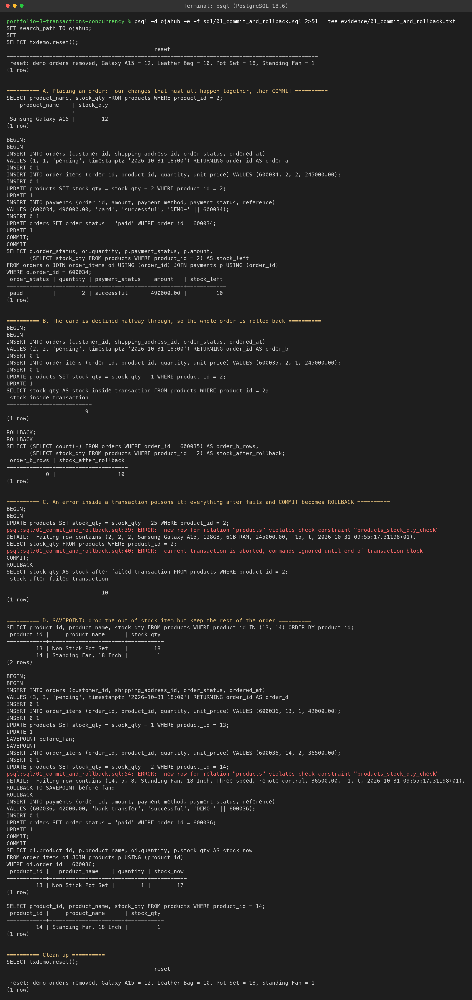
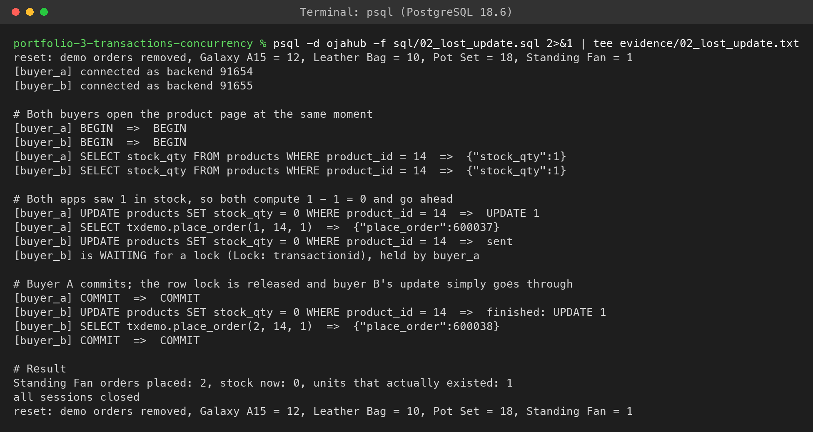
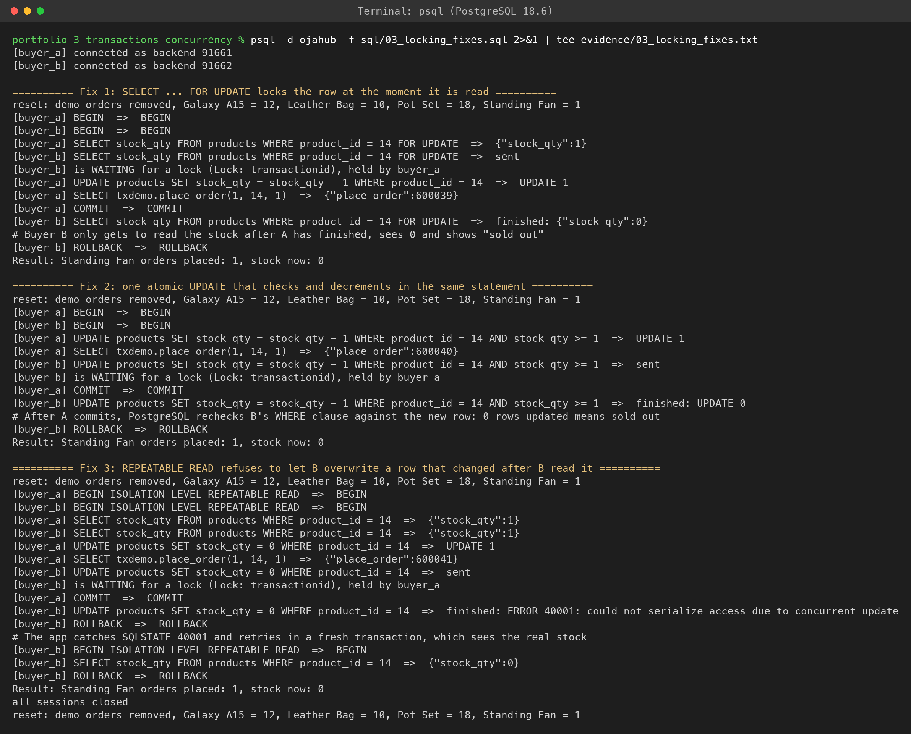
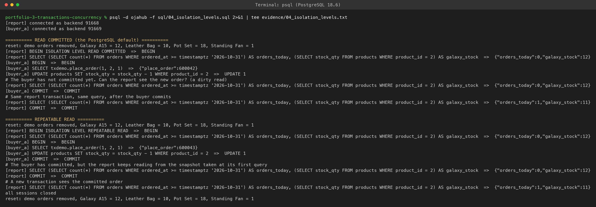
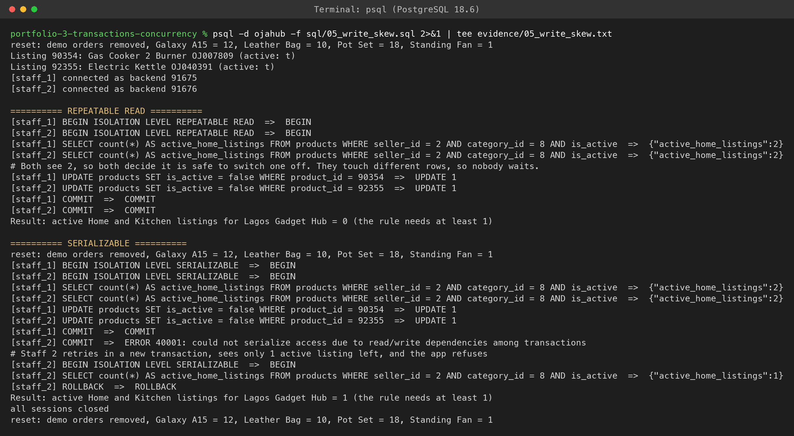
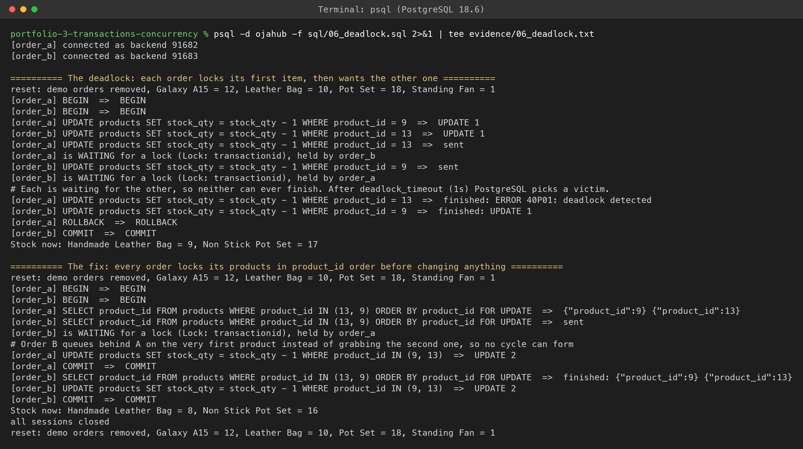

# Portfolio 3: Transactions and Concurrency

This activity looks at what happens to OjaHub when things go wrong halfway through, and when several people touch the same data at the same moment. Each scenario is a script that really runs against the Portfolio 2 database, and every result quoted here comes from the evidence files.


## What Is in This Folder

| File | Purpose |
| --- | --- |
| [sql/00_setup.sql](sql/00_setup.sql) | Helpers for running several real sessions from one script |
| [sql/01_commit_and_rollback.sql](sql/01_commit_and_rollback.sql) | Commit, rollback, an aborted transaction and a savepoint |
| [sql/02_lost_update.sql](sql/02_lost_update.sql) | The concurrency problem: two orders for one fan |
| [sql/03_locking_fixes.sql](sql/03_locking_fixes.sql) | Three ways to fix it |
| [sql/04_isolation_levels.sql](sql/04_isolation_levels.sql) | What a running report sees under different isolation levels |
| [sql/05_write_skew.sql](sql/05_write_skew.sql) | A rule across two rows, broken and then protected by SERIALIZABLE |
| [sql/06_deadlock.sql](sql/06_deadlock.sql) | A deadlock and the lock ordering fix |
| [evidence/](evidence/) | Full output of each scenario |
| [screenshots/](screenshots/) | Screenshots of the same run |


## How I Simulated Several Users at Once

Concurrency problems only appear when two separate sessions overlap, and doing that by hand in two terminal windows is hard to repeat exactly. Instead I used PostgreSQL's own dblink extension. One psql script opens named connections such as `buyer_a` and `buyer_b`, and each one is a genuinely separate backend with its own transaction. The script then drives them step by step in a fixed order, so every run interleaves the same way.

The helpers in `00_setup.sql` print every step as a line of the form `[session] statement => outcome`, so the output reads like a timeline. When a step is expected to block on a lock, the script sends it without waiting, then checks `pg_stat_activity` to show that the session really is stuck and which session holds the lock. Errors come back with their real SQLSTATE.

Every demo order is stamped 31 October 2026 18:00, after the generated data ends, so a `reset()` helper can remove them and put the stock back. Each scenario resets at the start and again at the end, so the scripts can be run in any order and leave the Portfolio 2 data exactly as it was. I checked this by running every scenario twice and comparing the output. Apart from backend numbers and new order IDs, it was identical.


## Scenario 1: Commit, Rollback and Savepoints

This one uses a single ordinary session, run with `psql -e` so every statement is printed above its result.

**A. Commit.** Placing an order is four changes: the order row, the item, the stock and the payment. They are wrapped in one transaction so they succeed or fail together. After `COMMIT` the order is paid, the payment is ₦490,000 and the Galaxy A15 stock went from 12 to 10.

**B. Rollback.** A second customer starts an order and the stock drops to 9 inside the transaction. The card is then declined, so the app issues `ROLLBACK`. Afterwards the order does not exist at all and the stock is back at 10.

**C. An error poisons the transaction.** Taking 25 units from a stock of 10 breaks the CHECK constraint from Portfolio 1. After that, PostgreSQL refuses every statement in the transaction ("current transaction is aborted"), and when the script sends `COMMIT` the server answers `ROLLBACK`. Nothing half finished can be saved by accident.

**D. Savepoint.** A customer orders a pot set and two Standing Fans, but only one fan is left. I set a `SAVEPOINT` before adding the fans. When the stock CHECK fails, `ROLLBACK TO SAVEPOINT` undoes just the fan part, and the rest of the order is paid and committed. The final order contains only the pot set, pot stock is 17 and fan stock is still 1.


## Scenario 2: The Lost Update

This is the bug I most wanted to see for myself. Two buyers open the last Standing Fan at the same time, and the app does what a lot of real code does: it reads the stock, works out the new value, and writes it back.

| Step | buyer_a | buyer_b |
| --- | --- | --- |
| 1 | `BEGIN`, reads stock: 1 | `BEGIN`, reads stock: 1 |
| 2 | writes stock = 0, places order | |
| 3 | | writes stock = 0, and **waits** for buyer_a's row lock |
| 4 | `COMMIT` | |
| 5 | | update goes through, places order, `COMMIT` |

**Result: 2 orders placed for 1 fan, stock 0.**

What surprised me is that PostgreSQL did block buyer B, and the screenshot shows it waiting on buyer A's lock. But under READ COMMITTED, once A commits, B's update is simply applied to the new row. B is writing a value it calculated from stale data, and nothing tells it so. The stock CHECK cannot help either, because neither write goes below zero.


## Scenario 3: Three Fixes

I ran the same race three more times, each with a different control mechanism.

| Fix | What buyer B experiences | Result |
| --- | --- | --- |
| `SELECT ... FOR UPDATE` | Blocks at the read itself until A commits, then reads 0 and shows "sold out" | 1 order, stock 0 |
| `UPDATE ... SET stock_qty = stock_qty - 1 WHERE stock_qty >= 1` | Blocks, then PostgreSQL rechecks the WHERE clause against A's committed row and updates **0 rows** | 1 order, stock 0 |
| REPEATABLE READ | Blocks, then gets `ERROR 40001: could not serialize access due to concurrent update`; a retry sees 0 | 1 order, stock 0 |

All three work. The difference is where the decision happens. `FOR UPDATE` is pessimistic: it makes buyers queue from the moment they look. The conditional UPDATE does the check and the change in one statement, so there is nothing stale to act on. REPEATABLE READ is optimistic: it lets both try, and makes the loser retry.


## Scenario 4: Isolation Levels

A finance report runs inside one transaction and reads two things twice: how many orders were placed today (a new row can appear) and the Galaxy A15 stock (an existing row can change). In between, a buyer places and commits an order.

| Moment | READ COMMITTED | REPEATABLE READ |
| --- | --- | --- |
| First read | 0 orders, stock 12 | 0 orders, stock 12 |
| Buyer has written but not committed | 0 orders, stock 12 | |
| After the buyer commits, same report transaction | **1 order, stock 11** | **0 orders, stock 12** |
| New transaction | | 1 order, stock 11 |

Under READ COMMITTED there was no dirty read: the uncommitted order stayed invisible. But the same query gave two different answers inside one transaction. The changed stock is a non repeatable read, and the extra order is a phantom. Under REPEATABLE READ the report keeps reading from the snapshot taken at its first query, so its numbers stay consistent with each other until it starts a new transaction. In PostgreSQL this level also prevents phantoms, which is stricter than the SQL standard requires.


## Scenario 5: Write Skew

Some rules span more than one row, and row locks cannot protect those. The rule I used is that a seller must keep at least one active listing in every category they sell in. Lagos Gadget Hub has exactly two Home and Kitchen listings: a gas cooker and an electric kettle.

Two staff members each switch off a different one. Each first checks that two are active, so each thinks it is safe. Because they update different rows, nobody ever waits for anyone.

| Isolation level | What happened | Active listings left |
| --- | --- | --- |
| REPEATABLE READ | Both commits succeed | **0**, rule broken |
| SERIALIZABLE | Staff 1 commits; staff 2's `COMMIT` fails with `ERROR 40001: could not serialize access due to read/write dependencies among transactions`. The retry sees 1 left and refuses | 1, rule kept |

This was the most interesting result for me. Nothing in the data conflicts row by row, so only SERIALIZABLE, which tracks what each transaction read as well as what it wrote, can spot that the two decisions were based on a state that no longer exists.


## Scenario 6: Deadlock

Two orders both contain the leather bag and the pot set. Order A locks the bag first and order B locks the pot set first, and then each one asks for the other item.

The script shows both sessions waiting, each held by the other. After `deadlock_timeout` (1 second by default) PostgreSQL detects the cycle and aborts order A with `ERROR 40P01: deadlock detected`. Order B then finishes, so only one order lands: bag 9, pot set 17.

The fix is to make every order lock its products in the same order before changing anything:

```sql
SELECT product_id FROM products WHERE product_id IN (13, 9) ORDER BY product_id FOR UPDATE;
```

Now order B queues behind order A on the very first product instead of grabbing the second one, so a cycle can never form. Both orders complete: bag 8, pot set 16.


## What I Would Use Where in OjaHub

| Situation | Mechanism |
| --- | --- |
| Taking stock at checkout | The conditional `UPDATE ... WHERE stock_qty >= quantity`. It is one statement, needs no retry logic, and zero rows updated means sold out |
| Orders with several items | Lock the products in product_id order with `FOR UPDATE` first, to avoid deadlocks |
| Reports and reconciliations | REPEATABLE READ, so every figure in the report comes from the same moment |
| Rules that span rows, like the active listing rule | SERIALIZABLE, with the app retrying on SQLSTATE 40001 |
| Anything with several steps | One transaction, with savepoints where part of the work is allowed to fail |

The common thread is that the safe options all need the application to cooperate: retry on 40001, treat 0 rows updated as an answer, and keep lock order consistent. The database gives you the tools, but they only work if the code uses them.


## Screenshots

All six come from a single run, starting with the helpers recreated from scratch.

**1. Commit, rollback, aborted transaction and savepoint.**



**2. The lost update.** Buyer B waits for A's lock, then overwrites anyway: 2 orders, 1 fan.



**3. The three fixes.** Each ends with exactly one order.



**4. Isolation levels.** The same report query under READ COMMITTED and REPEATABLE READ.



**5. Write skew.** Broken under REPEATABLE READ, rejected under SERIALIZABLE.



**6. Deadlock.** Both sessions waiting on each other, the 40P01 victim, then the lock ordering fix.




## How I Ran It

From inside this folder, after Portfolio 2's data is loaded:

```bash
psql -d ojahub -v ON_ERROR_STOP=1 -f sql/00_setup.sql
psql -d ojahub -e -f sql/01_commit_and_rollback.sql 2>&1 | tee evidence/01_commit_and_rollback.txt
psql -d ojahub -f sql/02_lost_update.sql 2>&1 | tee evidence/02_lost_update.txt
psql -d ojahub -f sql/03_locking_fixes.sql 2>&1 | tee evidence/03_locking_fixes.txt
psql -d ojahub -f sql/04_isolation_levels.sql 2>&1 | tee evidence/04_isolation_levels.txt
psql -d ojahub -f sql/05_write_skew.sql 2>&1 | tee evidence/05_write_skew.txt
psql -d ojahub -f sql/06_deadlock.sql 2>&1 | tee evidence/06_deadlock.txt
```

The scenario scripts deliberately run without `ON_ERROR_STOP`, because several of them are meant to hit errors.


## What I Took Away From This

1. A transaction is only as safe as the logic inside it. The lost update happened inside perfectly valid transactions.
2. Blocking is not the same as protection. Buyer B waited for the lock and still oversold.
3. Row locks cannot see rules that span rows. Write skew needed SERIALIZABLE.
4. Deadlocks are a design problem, not bad luck. A consistent lock order removes them completely.
