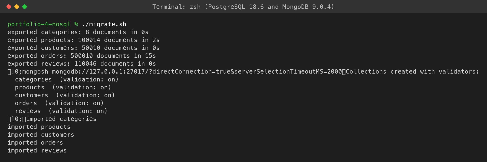
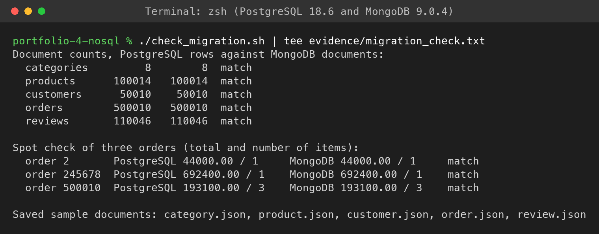
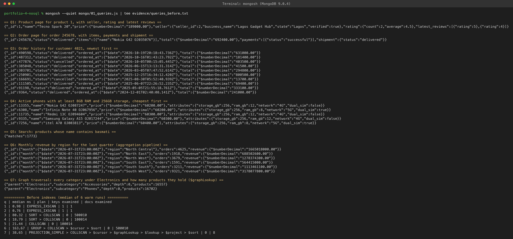
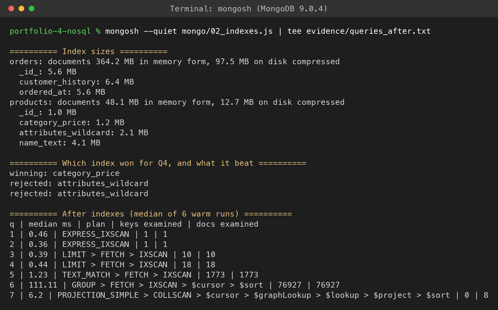
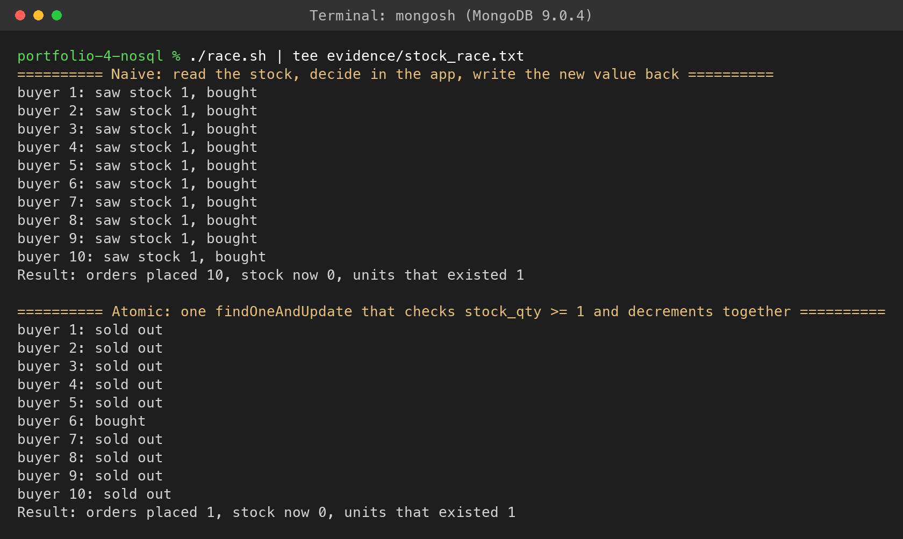
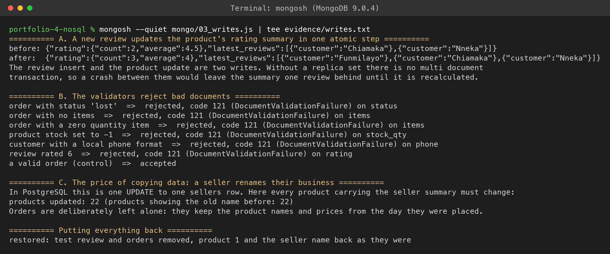
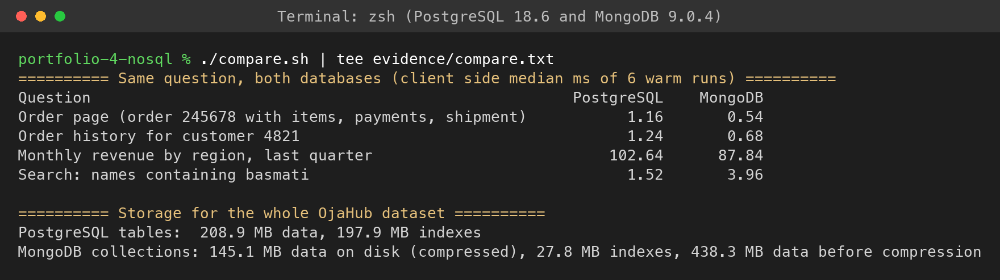

# Portfolio 4: NoSQL and Advanced Data Models

For this activity I modelled OjaHub as a document database in MongoDB, moved all of the Portfolio 2 data across, and then asked the same business questions of both databases. I wanted to find out where a document model genuinely fits a marketplace, and where it just moves the problems somewhere else.


## What Is in This Folder

| File | Purpose |
| --- | --- |
| [export/](export/) | PostgreSQL queries that build each MongoDB document |
| [migrate.sh](migrate.sh) | Exports from PostgreSQL and imports into MongoDB |
| [check_migration.sh](check_migration.sh) | Proves both databases hold the same data |
| [mongo/00_collections.js](mongo/00_collections.js) | Collections with schema validation |
| [mongo/queries.js](mongo/queries.js) | The seven queries, defined once |
| [mongo/01_queries.js](mongo/01_queries.js) | Results and plans before indexing |
| [mongo/02_indexes.js](mongo/02_indexes.js) | Indexes, then the same plans again |
| [race.sh](race.sh) | Ten concurrent buyers for one Standing Fan |
| [mongo/03_writes.js](mongo/03_writes.js) | Rating summary update, validation and the cost of copied data |
| [compare.sh](compare.sh) | The same questions timed in PostgreSQL and MongoDB |
| [sample-documents/](sample-documents/) | One real document from each collection |
| [evidence/](evidence/) | Full output of the final run |
| [screenshots/](screenshots/) | Screenshots of the same run |

I used MongoDB Community 9.0.4 and mongosh 2.14.1, installed with Homebrew and running locally as a single server.


## Why a Document Model for OjaHub

Two things about OjaHub pushed me towards documents.

**The catalogue does not fit neat columns.** A phone has storage, RAM and network. A piece of Ankara has yards, material and pattern. Rice has a weight and a shelf life. In PostgreSQL I would need either a column for every possible attribute, mostly empty, or a separate attribute table that is awkward to query. In a document, each product simply carries the attributes that make sense for it.

**Orders are read and written as a whole.** When a customer opens an order, they want the items, the payment attempts and the delivery status together. In PostgreSQL that is an eight table join. An order also has to remember things exactly as they were on the day: the address it went to and the price that was paid, even if the customer moves or the seller changes the price later. Embedding those as a snapshot is natural in a document.


## The Model

| Collection | Documents | What is inside, and why |
| --- | --- | --- |
| `products` | 100,014 | Category specific `attributes`, a copy of the seller's name, state and verification, the category with its parent, a rating summary and the 3 latest reviews. The product page is one read |
| `orders` | 500,010 | Items with name and price as sold, the shipping address as it was, every payment attempt and the shipment. The order page is one read |
| `customers` | 50,010 | Profile with addresses embedded, since a customer only ever has a handful |
| `reviews` | 110,046 | Kept separate and referenced by product_id, because a popular product could gather thousands. Only the latest 3 are copied into the product |
| `categories` | 8 | Each one points to its parent, which makes the category tree a small graph |

The general rule I followed: **embed what is read together and bounded in size, reference what can grow without limit.** Reviews are the one place that needed both, which is known as the subset pattern.

Here is a trimmed real order (the full one is in [sample-documents/order.json](sample-documents/order.json)). It is Ibrahim's sandals, with his failed card payment and the bank transfer that followed, all in one document:

```json
{
  "_id": 2,
  "customer": { "customer_id": 2, "name": "Ibrahim Musa" },
  "status": "delivered",
  "shipping_address": { "street": "7 Zoo Road", "city": "Kano", "state": "Kano", "region": "North West" },
  "items": [ { "product_id": 8, "name": "Leather Sandals", "quantity": 2, "unit_price": { "$numberDecimal": "22000.00" } } ],
  "total": { "$numberDecimal": "44000.00" },
  "payments": [
    { "method": "card", "status": "failed", "amount": { "$numberDecimal": "44000.00" }, "reference": "OJH-PAY-000002" },
    { "method": "bank_transfer", "status": "successful", "amount": { "$numberDecimal": "44000.00" }, "reference": "OJH-PAY-000003" }
  ],
  "shipment": { "courier": "Red Star Express", "tracking_number": "RSE5521840017", "status": "delivered" }
}
```

Money is stored as Decimal128 rather than ordinary floating point numbers, so naira amounts are exact.

One honest note: PostgreSQL never had category specific attributes, so the export generates them from the product_id. The same product always gets the same attributes, and where a seed product's description already states its specs, those are used.


## Schema Validation

A common worry with NoSQL is that anything can be stored. MongoDB supports `$jsonSchema` validators, so I created every collection with one before importing anything: required fields, the order and payment status lists, Decimal128 money above zero, stock that cannot go negative, ratings from 1 to 5 and the +234 phone format.

The import ran with `--stopOnError`, so all 760,088 documents passed validation on the way in. The write tests then tried six kinds of bad data, and each was rejected with code 121 (DocumentValidationFailure), naming the field that failed: an unknown order status, an order with no items, a zero quantity, negative stock, a local phone format and a rating of 6. A valid order used as a control was accepted.


## Migration

PostgreSQL builds each document itself, using `json_build_object` and `json_agg`, and writes JSON lines that `mongoimport` loads. [migrate.sh](migrate.sh) does the whole thing from an empty MongoDB database.

[check_migration.sh](check_migration.sh) then compares the two databases. All five collections have exactly as many documents as PostgreSQL has rows. Three orders spot checked on both sides have the same total and item count.

The best check came from the queries, though. MongoDB's revenue pipeline reports 4,625 orders and ₦1,665,018,000 for North Central in August, which is exactly what PostgreSQL's Q2 returned in Portfolio 2, even though the data is shaped completely differently.


## Queries, Before and After Indexing

The seven queries are defined once in [mongo/queries.js](mongo/queries.js), so the before and after runs use identical queries. Times are measured from mongosh, as the median of 6 warm runs.

| Query | Before (ms) | After (ms) | Plan after | Documents examined, before then after |
| --- | --- | --- | --- | --- |
| Q1 product page | 0.98 | 0.46 | `_id` lookup | 1, 1 |
| Q2 order page | 0.76 | 0.36 | `_id` lookup | 1, 1 |
| Q3 customer history | 80.32 | 0.39 | IXSCAN on customer_history | 500,010, 10 |
| Q4 phones by RAM and storage | 18.79 | 0.44 | IXSCAN on category_price | 100,014, 18 |
| Q5 search for basmati | 21.44 | 1.23 | text index | 100,014, 1,773 |
| Q6 revenue by region | 163.67 | 111.11 | IXSCAN on ordered_at | 500,010, 76,927 |
| Q7 category tree ($graphLookup) | 38.65 | 6.20 | category_price inside the lookup | |

Q1 and Q2 were already single key reads on `_id`, so their small change is just noise from timing on the client.

**Q4 surprised me.** I added a wildcard index over every attribute, since that is the textbook answer for flexible fields. The planner tried it and rejected it in favour of the plain `category_price` index. Walking phones in price order finds five matching phones after reading 18 documents, which is cheaper than matching on one attribute and then sorting. The wildcard index would matter more for a search on a rare attribute across all categories.

**Q5 changes query, not just plan.** Before the text index exists, a search has to use a case insensitive regex and scan everything. After, it uses `$text`. Both found the same 1,773 products, but `$text` matches whole words, while the regex and PostgreSQL's trigram index match any substring.

**Q7 is the graph example.** `$graphLookup` starts at Electronics and follows `parent_id` links down the category tree, then counts the products in each subcategory: 16,702 phones and 16,557 accessories. After indexing, the lookup inside the pipeline counts all 33,261 products straight from the `category_price` index without reading a single document, which is where the drop from 38.65 ms to 6.20 ms comes from. With only two levels this is a small graph, but the same stage would walk a deep tree or a referral chain without knowing its depth in advance.

Full output: [queries_before.txt](evidence/queries_before.txt) and [queries_after.txt](evidence/queries_after.txt).


## Writes and Concurrency

**The stock race again.** In Portfolio 3, two buyers oversold the last Standing Fan in PostgreSQL. [race.sh](race.sh) repeats it with ten separate mongosh processes that all start at the same instant. When each buyer reads the stock and writes back a value it worked out itself, **all ten buy the one fan**. When each uses a single `findOneAndUpdate` that checks `stock_qty >= 1` and decrements in the same step, **exactly one buyer gets it** and the other nine see sold out. It is the same lesson as the conditional UPDATE in Portfolio 3: a single document update in MongoDB is atomic.

**Keeping a summary in step.** Adding a review also has to update the product's rating summary and latest reviews. I did that with one pipeline update evaluated on the server, so the average is calculated from the current document and no other writer can slip in between. Product 1 went from 2 reviews averaging 4.5 to 3 reviews averaging 4. The weakness is that inserting the review and updating the product are still two separate writes. On a single server MongoDB has no multi document transactions, so a crash between them would leave the summary one review behind until it is recalculated. MongoDB needs a replica set before it allows multi document transactions, which I will look at in Portfolio 5.

**The price of copying data.** When Lagos Gadget Hub renames itself, PostgreSQL changes one row in `sellers`. In MongoDB, all 22 of its products carry a copy of the seller summary, so all 22 have to be updated. Orders are deliberately left alone, because they should keep the names and prices from the day they were placed. This is the real cost of denormalising: reads get simpler, while some writes fan out.

Every change in the write tests is undone in a `finally` block, so a failing step cannot leave test data behind.


## PostgreSQL and MongoDB Side by Side

[compare.sh](compare.sh) asks four questions of both databases and times them the same way, from the client, as the median of 6 warm runs. These are client side times, so they are not directly comparable with the server side numbers in Portfolio 2.

| Question | PostgreSQL (ms) | MongoDB (ms) |
| --- | --- | --- |
| Order page with items, payments and shipment | 1.16 | 0.54 |
| Order history for one customer | 1.24 | 0.68 |
| Monthly revenue by region, last quarter | 102.64 | 87.84 |
| Product name search for basmati | 1.52 | 3.96 |

| Storage | PostgreSQL | MongoDB |
| --- | --- | --- |
| Data | 208.9 MB | 438.3 MB before compression, 145.1 MB on disk |
| Indexes | 197.9 MB | 27.8 MB |

I read the timings as: MongoDB wins clearly when one document answers the whole question (the order page), the two are close on indexed lookups and on the report, and PostgreSQL wins on substring search, thanks to its trigram index. At this scale every lookup is around a millisecond on either side, so the difference that matters more is the shape of the work, not the raw speed.

The storage result cuts both ways. All the copied snapshots make MongoDB's raw data about twice the size of PostgreSQL's tables. But WiredTiger compresses it on disk to below PostgreSQL's size, and MongoDB's indexes are far smaller, partly because PostgreSQL also carries the extra indexes I added in Portfolio 2.

Full output: [compare.txt](evidence/compare.txt).


## Is a Document Database Suitable for OjaHub?

For parts of it, yes. Looking at all of the evidence, this is how I would split it:

| Part of OjaHub | Better fit | Why |
| --- | --- | --- |
| Product catalogue | MongoDB | Different attributes per category, one read per product page, flexible search on attributes |
| Order history and order pages | MongoDB | The order is one unit that is read whole and should keep a snapshot of the day it was placed |
| Payments, refunds and stock | PostgreSQL | Money and stock need multi row transactions, foreign keys and SERIALIZABLE when rules span rows, which Portfolio 3 showed matter |
| Reporting across everything | PostgreSQL | Joins, materialised views and ad hoc questions nobody planned the documents around |

So my conclusion is that OjaHub suits **polyglot persistence**: PostgreSQL as the system of record for money and stock, with MongoDB serving the catalogue and order pages that customers read all day. A graph database such as Neo4j would only start to earn its place if OjaHub added "customers who bought this also bought" recommendations, which are deep relationship walks that neither of these handles well.


## Screenshots

All seven come from a single run, starting with an empty MongoDB database.

**1. Migration.** Export from PostgreSQL and import into validated collections.



**2. Migration check.** Every count matches, and the three spot checked orders agree.



**3. Queries before indexing.** Results for all seven, then the plans: collection scans everywhere except the `_id` lookups.



**4. After indexing.** Index sizes, the Q4 index race, and the new plans.



**5. The stock race.** Ten buyers, naive then atomic.



**6. Write tests.** Rating summary, validation rejections and the seller rename.



**7. PostgreSQL against MongoDB.**




## How I Ran It

From inside this folder, with PostgreSQL holding the Portfolio 2 data:

```bash
brew tap mongodb/brew
brew install mongodb/brew/mongodb-community mongosh
brew services start mongodb/brew/mongodb-community

./migrate.sh
./check_migration.sh | tee evidence/migration_check.txt
mongosh --quiet mongo/01_queries.js | tee evidence/queries_before.txt
mongosh --quiet mongo/02_indexes.js | tee evidence/queries_after.txt
./race.sh | tee evidence/stock_race.txt
mongosh --quiet mongo/03_writes.js | tee evidence/writes.txt
./compare.sh | tee evidence/compare.txt
```

The exported JSON files go to `data/`, which is gitignored because they come to a few hundred megabytes and can be regenerated in seconds.


## What I Took Away From This

1. Design the documents around the questions you will ask, not around the entities. That is the opposite of how I designed the relational schema in Portfolio 1.
2. Schemaless does not have to mean unvalidated. `$jsonSchema` caught every bad document I tried.
3. Single document atomicity is powerful. Embedding the whole order is what makes it enough.
4. Denormalising is a trade, not a free win: faster reads in exchange for bigger raw data and writes that fan out.
5. The right answer for a real system is often both databases, each doing the part it is good at.
