# Portfolio 5: Distributed and Cloud Database Exercise

For the last activity I spread OjaHub across several database servers to see what replication, failover and sharding really do, rather than only reading about them. Everything below ran on my Mac as real separate server processes, and every number comes from the evidence files. The last section turns the results into a cloud deployment design for OjaHub.


## What Is in This Folder

| Folder | What it builds |
| --- | --- |
| [postgres-replication/](postgres-replication/) | A streaming replica of the PostgreSQL primary, then asynchronous and synchronous replication, and failover |
| [mongo-replica-set/](mongo-replica-set/) | A three member MongoDB replica set: write concern, stale reads, failover under traffic and a multi document transaction |
| [mongo-sharding/](mongo-sharding/) | A MongoDB sharded cluster with orders split by region, and how queries are routed |
| [evidence/](evidence/) | Full output of the final run |
| [screenshots/](screenshots/) | Screenshots of the same run |

Each folder has a `setup.sh` and a `teardown.sh`. The cluster files live outside the repo in `~/ojahub-cluster`, and teardown removes them. After the final run only the original PostgreSQL (5432) and MongoDB (27017) servers were still running, and both had the same row and document counts as before this portfolio started.


## Part A: PostgreSQL Streaming Replication

`setup.sh` clones the primary with `pg_basebackup` into a hot standby on port 5433. That took 3 seconds and 455 MB, and the primary immediately reported the replica as `streaming`. I deliberately did not use a replication slot. A forgotten slot makes the primary keep its WAL forever, and with little free disk on this laptop that felt like the wrong risk.

**Asynchronous replication.** An order placed on the primary had already been replayed on the replica by the first check, 34 ms later, and that 34 ms is mostly the time to start psql. While the primary wrote a million rows, I sampled the replica's lag every 0.2 seconds. It peaked at about 8 MB and 0.19 seconds behind, then caught up within a second of the write finishing, with 1,000,000 rows on both sides. Any write sent to the replica was refused with `cannot execute UPDATE in a read-only transaction`.

**Synchronous replication.** With `synchronous_standby_names` set, the primary waits for the replica on every commit. pgbench timed 500 commits each way:

| Setting | What the primary waits for | Average commit |
| --- | --- | --- |
| Asynchronous | Nothing from the replica | 0.089 ms |
| `synchronous_commit = on` | The replica has the commit safely on disk | 0.143 ms |
| `synchronous_commit = remote_apply` | The commit is also visible to queries on the replica | 0.139 ms |

Both servers are on one machine, so the "network" is a local socket. That is why the cost is only about half as much again per commit, and why `remote_apply` beating `on` by a few microseconds is just noise. Across two real data centres, every commit would add a network round trip.

**The price of synchronous replication.** Then I stopped the replica while the primary was still synchronous, and placed an order with `statement_timeout` set to 3 seconds. The commit just waited. The timeout never fired, because PostgreSQL switches it off before the commit step, and in my first attempt the order sat there for over five minutes. The only way out was to cancel the stuck backend, and PostgreSQL answered with a warning that the transaction "has already committed locally, but might not have been replicated to the standby". So the customer gets an error for an order that actually exists. When the replica came back it caught up, and both sides had the same 1,501 rows.

**Failover.** Promoting the replica with `pg_promote()` took 133 ms and moved it to timeline 2, after which it accepted orders. But the old primary was still running, so both servers kept taking orders that the other never saw. In one run they even gave the same order number to two different customers. In the final run the numbers were 32 apart, only because a promoted server can skip ahead in its sequences (PostgreSQL logs sequence values 32 at a time), so they would collide 32 orders later. This is split brain, and it is why real failover tools fence the old primary before promoting anything.


## Part B: MongoDB Replica Set

`setup.sh` starts three members on ports 27018 to 27020 as the replica set `ojahub-rs`, and copies in the products, reviews and orders, with their validators and indexes.

**Write concern.** I timed 300 writes for each setting:

| Write concern | Meaning | Average write |
| --- | --- | --- |
| `w: 1` | Primary only, in memory | 0.503 ms |
| `w: 1, j: true` | Primary only, on disk | 5.589 ms |
| `w: 3` | All three members, in memory | 0.654 ms |
| `w: 3, j: true` | All three members, on disk | 8.122 ms |
| `w: "majority"` | Two of three, on disk by default | 7.352 ms |

I first expected the number of members to drive the cost. It does not. Waiting for all three members in memory is almost free. The real cost is waiting for the on disk journal, and majority writes are journaled by default.

**Stale reads.** I wrote a value to the primary and immediately read it back from a secondary, 300 times. **126 of the 300 reads returned the old value.** The same loop inside a causally consistent session, with majority writes and reads, returned **0** stale values. So for something like a customer's "my orders" page, reading from secondaries is only safe inside a causal session.

**Failover under traffic.** A writer made a majority write every 100 ms while I killed the primary's process with `kill -9`, which is a crash rather than a clean shutdown.

| What happened | Result |
| --- | --- |
| Writes were unavailable for | about 10.4 seconds |
| Attempts during the run | 177, of which 4 failed with a server selection error |
| New primary | 27019 |
| Acknowledged writes lost | 0 of 173 |
| Old member restarted | back as a secondary after 8 s, primary again after 19 s (it has the highest priority) |

The 10 second gap is MongoDB's default election timeout. Not a single acknowledged majority write was lost, which is exactly what majority write concern promises.

**Transactions.** In Portfolio 4, adding a review and updating the product's rating summary were two separate writes, because a single MongoDB server cannot run multi document transactions. On the replica set they run in one snapshot transaction. Another connection kept seeing the old rating (2 reviews, 4.5) until commit. A second transaction that was aborted halfway left neither the review nor the rating change behind.


## Part C: Sharding Orders by Region

`setup.sh` builds a sharded cluster: a config server, two shards called `north` and `south`, and a `mongos` router that applications talk to.

Orders are sharded on `{ shipping_address.region, _id }`, with zones that pin the three northern regions to the north shard and the three southern regions to the south shard. That is the kind of placement a company would want if it ran one data centre in the north and one in Lagos. All 500,010 orders loaded through the router in 16 seconds. Asked directly, each shard holds only its own half of the country:

| Shard | Orders | Regions |
| --- | --- | --- |
| north | 209,572 | North Central 94,894, North East 38,372, North West 76,306 |
| south | 290,438 | South East 32,044, South South 67,341, South West 191,053 |

The split is uneven because Lagos alone is most of the South West. A real deployment would watch for this, because the south shard does more work.

**How queries are routed:**

| Query | Region in the filter? | Shards asked | Documents examined |
| --- | --- | --- | --- |
| One order by region and `_id` | Yes, full shard key | 1 | north 1 |
| Pending orders in North West | Yes | 1 | north 76,306 |
| Revenue for South West, last quarter | Yes | 1 | south 44,682 |
| Revenue by region, last quarter | No | 2, merged on the router | north 32,245, south 44,682 |
| Order history for customer 4821 | No | 2, merge sorted | north 0, south 10 |

Queries that name a region go to one shard. The customer's order history does not include the shard key, so the router has to ask both shards, even though all of that customer's orders are in the south.

I also learned that targeting only reduces how many shards do the work, not how much each one does. The North West query still read every North West order, because the shards have no index on status. The shard key decides which questions are cheap, so it has to be chosen around the most common queries.


## Part D: Cloud Deployment Design for OjaHub

Putting the three parts together, this is how I would run OjaHub in production.

**PostgreSQL for money and stock.** A managed PostgreSQL service with the primary in one availability zone and a synchronous standby in another. Part A showed what synchronous replication buys: a committed payment exists in two places, so the recovery point objective is zero. It also showed what it costs: if the standby disappears, commits stop. A managed service handles that by dropping back to asynchronous mode or promoting with fencing, which is the split brain lesson from the failover test. One or two asynchronous read replicas would serve reports and the materialised views from Portfolio 2, where being a fraction of a second behind is fine.

**MongoDB for the catalogue and order pages.** A three member replica set spread across three availability zones, as in Part B, for example on MongoDB Atlas. Writes use majority write concern, so a crash loses nothing that was acknowledged. Catalogue browsing can read from secondaries, since a product page being a fraction of a second old does no harm. The "my orders" page uses causally consistent sessions, so customers always see their own new orders. Part B measured the 10 second election, so the app should retry writes for at least that long instead of showing an error.

**Sharding only when it is needed.** 500,000 orders fit comfortably on one replica set. If OjaHub outgrew that, I would shard by region with zones, as in Part C, so northern and southern orders live closer to their customers. The cost is that queries across the whole country, like a customer's history, have to visit every shard. Order history would need an index on the customer on every shard, or a different shard key such as customer_id with a hashed distribution if that query dominated.

**Location and data residency.** The major cloud providers' nearest full regions are in South Africa, such as AWS Cape Town and Google Cloud Johannesburg, and Nigeria's Data Protection Act 2023 sets rules on how personal data is processed and transferred. A real deployment would check whether customer data may be held outside Nigeria, and consider local data centres in Lagos for the primary copy if not.

**Backups and recovery.** Replication is not a backup: a mistaken `DELETE` replicates instantly to every copy. PostgreSQL needs continuous WAL archiving for point in time recovery, and MongoDB needs continuous cloud backups, with a restore tested regularly.

**CAP and PACELC, in practice.** CAP says that during a network partition a system must choose between consistency and availability. PACELC adds that even without a partition, it trades latency against consistency. My results map onto that directly:

| Setting | During a failure | Normal running |
| --- | --- | --- |
| PostgreSQL synchronous | Chooses consistency: commits block when the standby is gone (Part A) | Pays latency on every commit |
| PostgreSQL asynchronous | Chooses availability, but a failover can lose the last few commits | Low latency, replica slightly behind (8 MB at peak) |
| MongoDB majority writes | Chooses consistency: about 10 s without writes during an election, nothing lost (Part B) | Pays the journal wait, about 7 ms here |
| MongoDB secondary reads | Stay available | Low latency but can be stale: 126 of 300 reads here |

For OjaHub I would choose consistency for payments and stock, and latency for browsing.


## Screenshots

All eleven come from a single clean run, where each part was built from nothing and torn down afterwards.

**Part A: PostgreSQL**

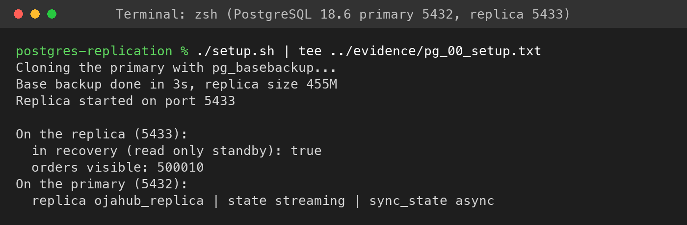

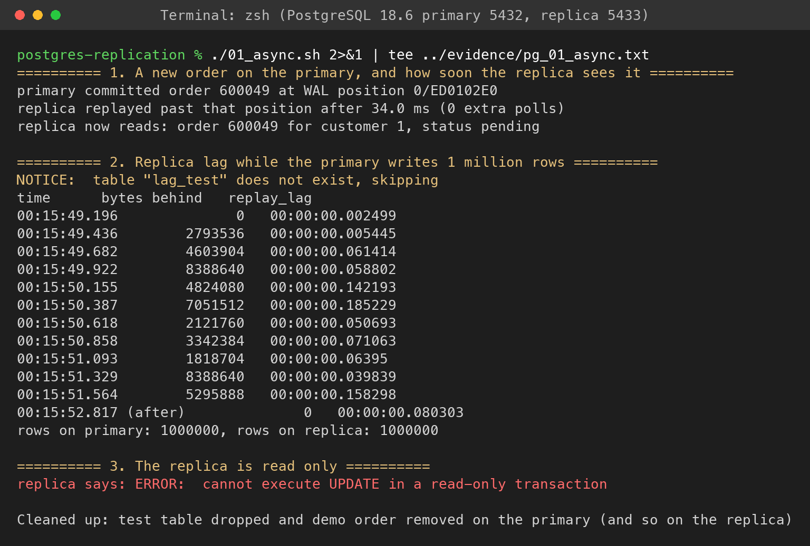

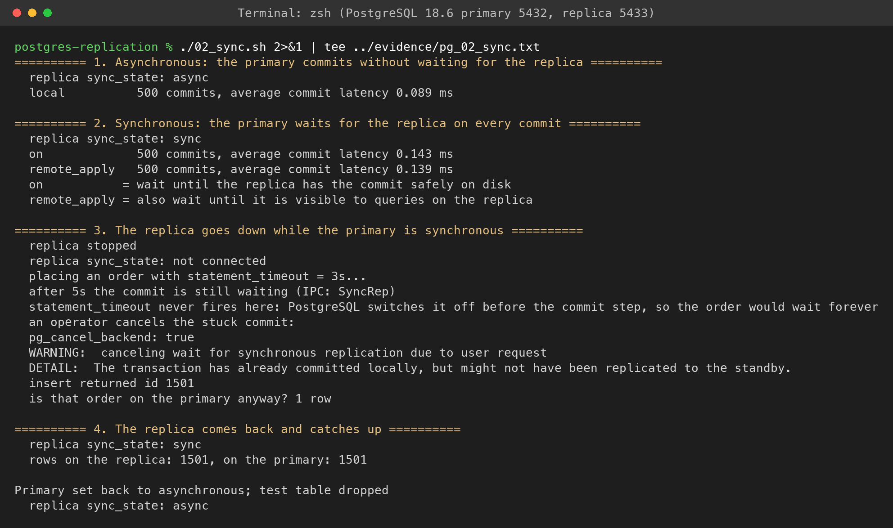

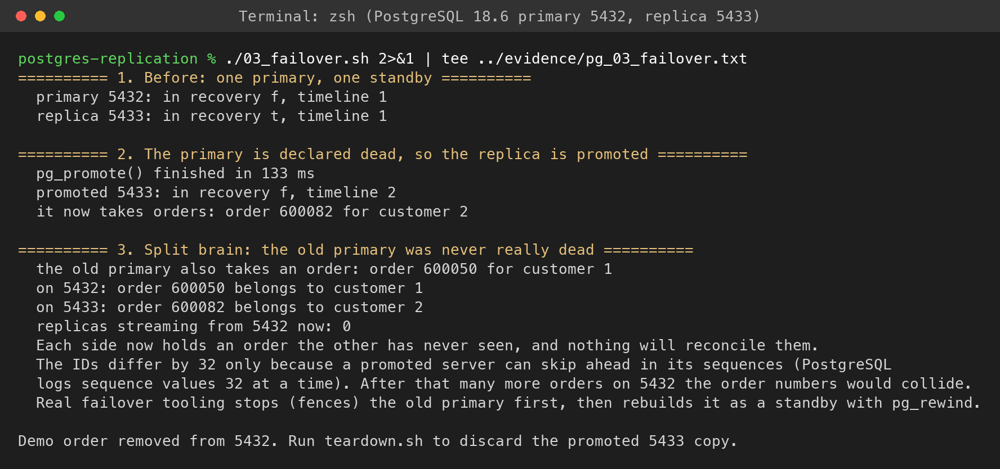

**Part B: MongoDB replica set**

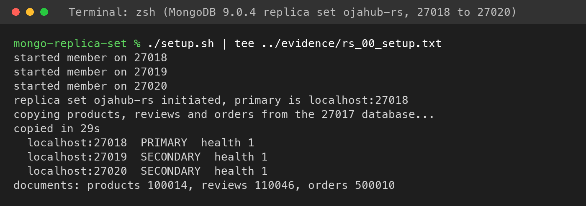

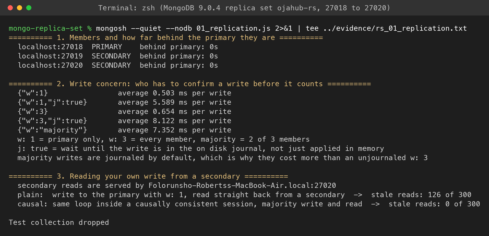

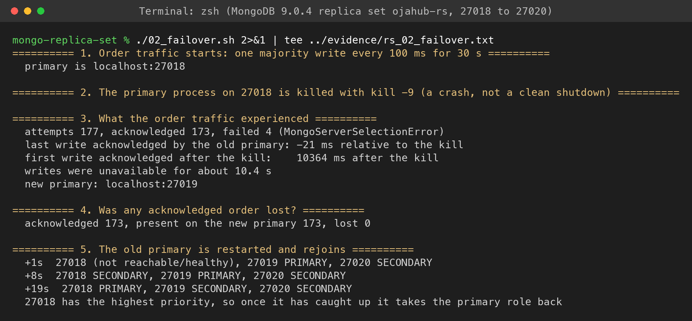

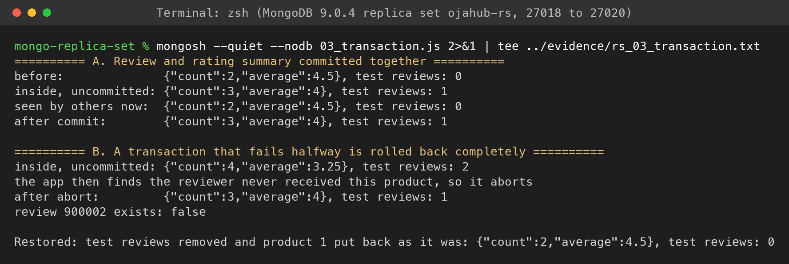

**Part C: MongoDB sharding**

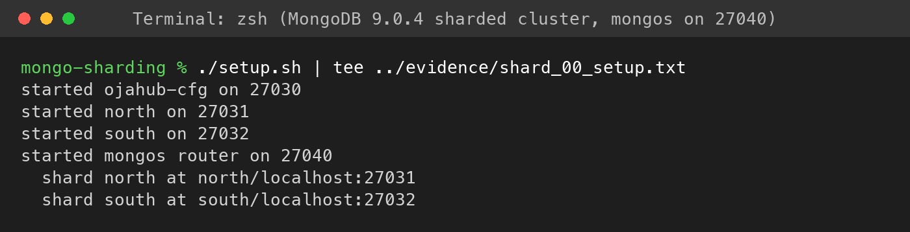

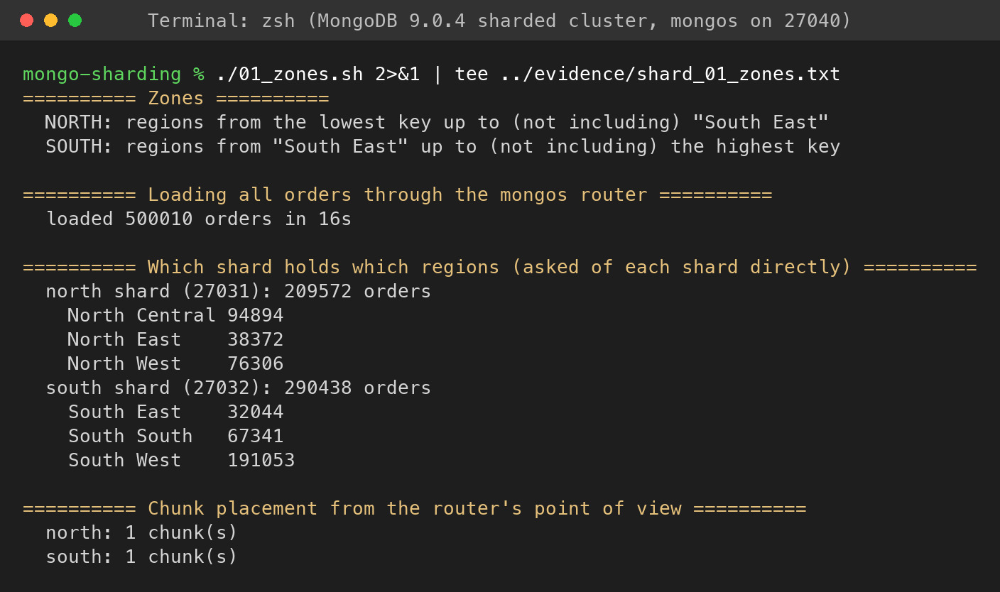

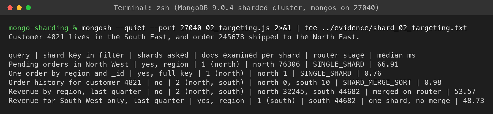


## How I Ran It

Each part runs from inside its own folder, with the Portfolio 2 data in PostgreSQL and the Portfolio 4 data in MongoDB:

```bash
cd postgres-replication
./setup.sh && ./01_async.sh && ./02_sync.sh && ./03_failover.sh && ./teardown.sh

cd ../mongo-replica-set
./setup.sh
mongosh --quiet --nodb 01_replication.js
./02_failover.sh
mongosh --quiet --nodb 03_transaction.js
./teardown.sh

cd ../mongo-sharding
./setup.sh && ./01_zones.sh && mongosh --quiet --port 27040 02_targeting.js && ./teardown.sh
```

I ran everything under `caffeinate -dimu`, because the Mac went to sleep on battery twice in the middle of a run. The first time it made a two second write look like five minutes, and macOS's power log confirmed the sleep, not the database, was the cause.


## What I Took Away From This

1. Every copy of the data is a promise you have to keep. Synchronous replication protects payments, but it turns a dead standby into a stuck checkout.
2. Failover is the easy part. Making sure the old primary is really gone is the hard part, as the split brain run showed.
3. Read the defaults. Majority writes cost what they do because of journaling, and `statement_timeout` quietly does not apply to a synchronous commit.
4. The shard key decides which questions are cheap. Region made regional reports single shard, and made customer history ask everyone.
5. Distributed databases do not remove trade offs, they make you pick them on purpose. CAP stopped being theory once I had timed both sides of it.
